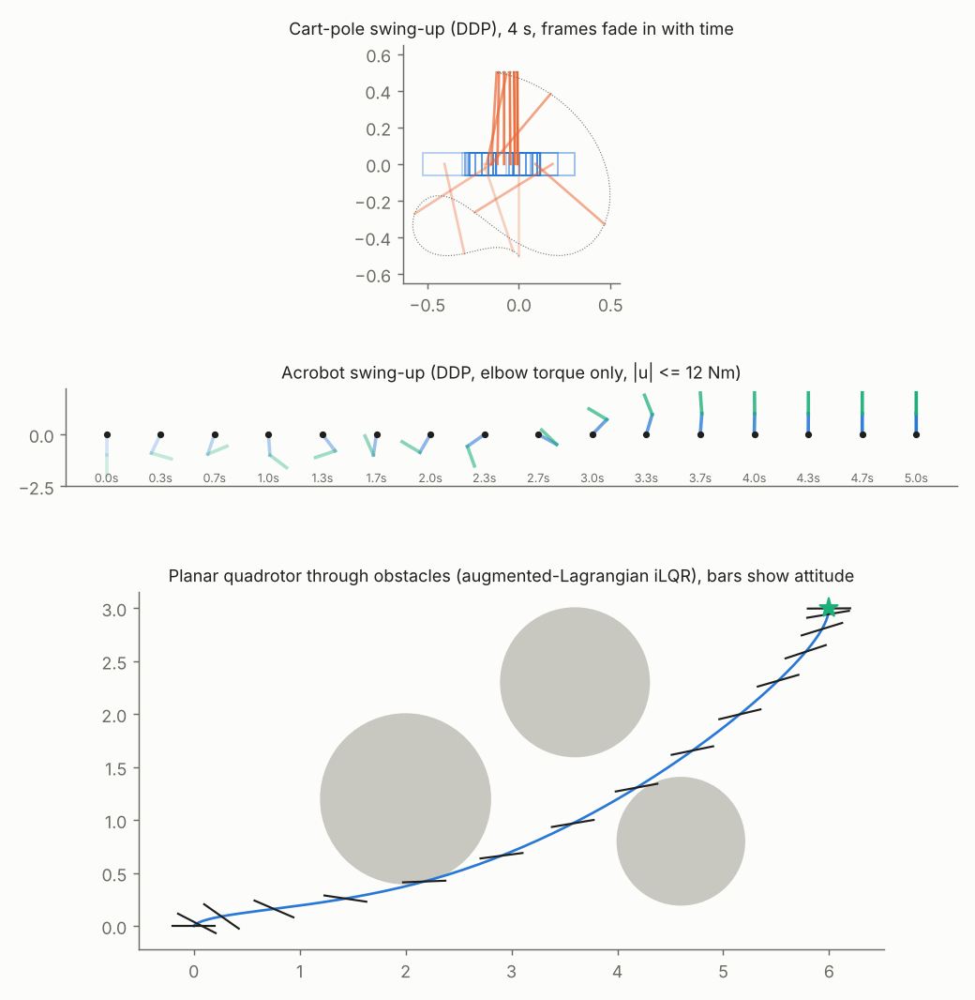
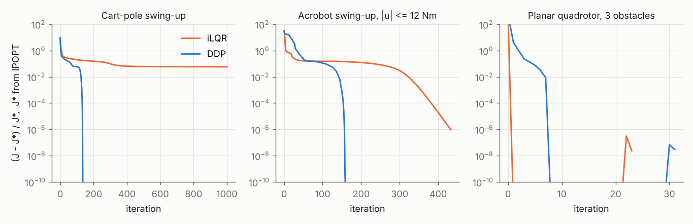
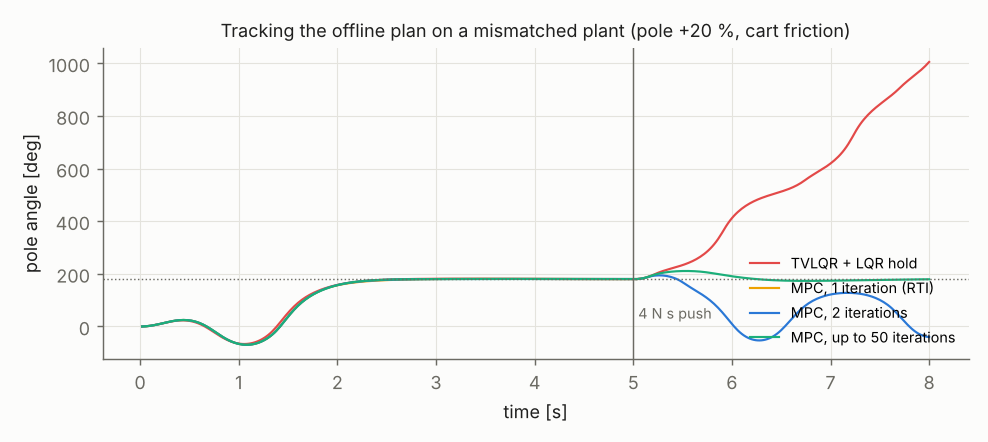

# DDP Forge: Constrained iLQR and DDP with Template Autodiff in C++

A header-only C++ trajectory optimizer that solves the same problems two ways, iLQR (Gauss-Newton) and full second-order DDP, and checks itself against IPOPT. Dynamics are written once as templates over the scalar type. Evaluating them with `Dual<double>` gives exact Jacobians, and with `Dual<Dual<double>>` gives the second-order tensor terms DDP needs, so nothing is hand-differentiated or finite-differenced. Input limits and obstacle constraints are handled by an augmented Lagrangian wrapped around the unconstrained solver, in the style of ALTRO. The same solver then runs as a receding-horizon MPC on a cart-pole with model mismatch and pushes.

Every optimal cost reported here was independently confirmed by rebuilding the problem in CasADi with the identical RK4 discretization and warm-starting IPOPT at the C++ solution. Where the C++ solver had stopped early, IPOPT walked away from it, and that is how the most interesting result in this repo was found.



## How to run

```bash
./scripts/run_all.sh                   # build, 8 test suites, solves, MPC, IPOPT cross-check, plots (~2 min)
docker build -t ddp-forge . && docker run --rm ddp-forge     # C++ build and tests
```

## Method

Discrete dynamics are $x_{k+1} = F(x_k, u_k)$, one RK4 step of the continuous model at $\Delta t = 0.02$ s. The backward pass forms

$$Q_x = \ell_x + F_x^\top V'_x, \quad Q_u = \ell_u + F_u^\top V'_x, \quad Q_{uu} = \ell_{uu} + F_u^\top V'_{xx} F_u + \sum_i V'_{x,i}\, \nabla^2_{uu} F_i + \rho I$$

(and likewise $Q_{xx}$, $Q_{ux}$). iLQR drops the tensor sum. DDP keeps it, and computes $\nabla^2 (V_x'^\top F)$ by seeding one nested dual per pair of input directions. The gains are $k = -Q_{uu}^{-1} Q_u$ and $K = -Q_{uu}^{-1} Q_{ux}$, and the forward pass backtracks on the ratio of actual to predicted cost reduction.

Constraints $c(x, u) \le 0$ enter through the Powell-Hestenes-Rockafellar penalty $\frac{1}{2\mu}\left(\max(0, \lambda + \mu c)^2 - \lambda^2\right)$, with multiplier updates $\lambda \leftarrow \max(0, \lambda + \mu c)$ and $\mu \leftarrow 10\mu$ between inner solves.

Problems: cart-pole swing-up (4 s, with and without ±10 N limits), acrobot swing-up with only the elbow actuated (5 s, ±12 N m), and a planar quadrotor flying to a goal past three circular obstacles with thrust limits of 0 to 8 N per rotor.

## Results

### Offline solves against IPOPT

| Problem | Solver | Converged | Iterations | Cost | IPOPT warm-started there | Time |
|---|---|---|---|---|---|---|
| Cart-pole | iLQR | no (cap) | 1000 | 114.6 | 108.5 | 236 ms |
| Cart-pole | DDP | yes | 136 | 108.50 | 108.50 (gap 7e-10) | 172 ms |
| Cart-pole, ±10 N | iLQR | no (cap) | 1000 | 114.7 | 108.6 | 208 ms |
| Cart-pole, ±10 N | DDP | yes | 159 | 108.60 | 108.60 (gap 9e-9) | 202 ms |
| Acrobot, ±12 N m | iLQR | yes | 433 | 75.995 | 75.995 (gap 9e-7) | 149 ms |
| Acrobot, ±12 N m | DDP | yes | 159 | 75.995 | 75.995 (gap 3e-9) | 369 ms |
| Quadrotor, obstacles | iLQR | yes | 23 | 20.496 | 20.496 (gap 3e-8) | 6.3 ms |
| Quadrotor, obstacles | DDP | yes | 31 | 20.496 | 20.496 (gap 3e-8) | 55.5 ms |



DDP converged on every problem and matched IPOPT's local optimum to within 3.2e-8 relative cost. On the swing-ups it needed 2.7x (acrobot) to more than 7x (cart-pole) fewer iterations than iLQR, but each iteration costs 5 to 7x more because of the $(n_x + n_u)(n_x + n_u + 1)/2$ nested-dual passes per time step. On the acrobot that made DDP 2.5x slower in wall time despite needing a third of the iterations. On the quadrotor, where the costate stays small, iLQR was strictly better.

On the cart-pole, iLQR did not converge. It crawled with half-steps for 1,000 iterations and stayed 5.7 % above the optimum. Starting IPOPT from the iLQR result moved it to the DDP solution in 57 iterations, which confirms iLQR was not sitting at a stationary point. The Gauss-Newton model ignores $\sum_i V'_{x,i} \nabla^2 F_i$, and during a swing-up the costate $V'_x$ is large, so the model badly mispredicts the improvement of each step.

On the quadrotor, IPOPT started from the same naive guess (hover thrust, states at the origin) landed in a worse local optimum (22.92 vs 20.50). Warm-started at the C++ solution it stayed there. IPOPT through CasADi took 0.9 to 13.8 s, but that includes Python-side NLP construction, so it is not a fair speed comparison.

### Receding-horizon MPC on a mismatched plant

The offline DDP swing-up is tracked on a plant with a 20 % heavier pole and 0.5 N s/m of cart friction, starting from a randomly perturbed angle, with an impulse on the cart at t = 5 s. The MPC re-solves a 1.5 s tracking problem around the plan at 50 Hz, warm-started from its previous solution shifted by one step. The baseline is the time-varying LQR gains from the offline solve, followed by an infinite-horizon LQR at upright, both saturated at ±10 N. Twenty seeds per cell.

| Push | TVLQR + LQR | MPC, 1 iteration (RTI) | MPC, 2 iterations | MPC, 5 iterations | MPC, up to 50 |
|---|---|---|---|---|---|
| 2 N s | 100 % | 90 % | 100 % | 100 % | 100 % |
| 4 N s | 0 % | 25 % | 0 % | 100 % | 100 % |
| 6 N s | 0 % | 30 % | 100 % | 100 % | 100 % |



With the 5-iteration cap the mean solve time was 0.3 ms, p99 under 0.8 ms and the worst single solve 4.5 ms, all well inside the 20 ms control period. Once the push is large enough to saturate the cart force, the LQR has no way to plan around the limit and loses the pole, while the MPC handles the force limit as a constraint and recovers. The 2-iteration column is not monotone in push size (0 % at 4 N s, 100 % at 6 N s), so I would not deploy a budget that small without far more testing. Five iterations was the smallest budget that worked at every push size.

## What worked

Template autodiff removed an entire class of bugs. Jacobians match central differences to 1e-6 and nested-dual Hessians to 1e-5 on all three systems, and a separate check against differenced Jacobians matched to 1e-11.

The linear-quadratic sanity test was the most useful single test. On a double integrator with quadratic cost one iLQR iteration must land on the finite-horizon Riccati optimum, and it does to 4e-10 relative.

Warm-starting IPOPT at my solution is a cheap and decisive optimality check. It costs one extra solve and immediately separates "converged" from "stopped".

## What did not work

Regularizing $V_{xx}$ (Tassa's preferred scheme) made DDP fail outright. It adds $\rho F_u^\top F_u \approx \rho\,\Delta t^2$ to $Q_{uu}$, which is far too weak to cure the negative curvature the second-order terms introduce, so $\rho$ ran to its cap and DDP stopped after one or two iterations at 5 to 550x the optimal cost. Regularizing $Q_{uu}$ directly fixed it.

My first convergence test stopped on a small actual cost change. It reported iLQR "converged" on the cart-pole at a point IPOPT then walked 5.7 % downhill from. Stopping on the predicted first-order improvement fixed the false positive, and iLQR now correctly reports that it hit the iteration cap.

I nearly suppressed a real bug. GCC emitted `-Wmaybe-uninitialized` from inside Eigen, I added `-Wno-maybe-uninitialized`, and the finite-difference tests immediately failed with garbage. The cause was `const auto col = (step(xp) - step(xm)) / (2 * e);`, where `auto` captured an Eigen expression template referencing two temporaries that die at the semicolon. The flag is gone and the variable has a concrete type. This is the `auto` warning from the RoboJackets C++ training, in its most expensive form.

The first MPC aimed at the fixed goal angle $\pi$. A pole that fell over the top was then 2π from "upright" and the controller swung it all the way around. Re-anchoring the goal to the nearest upright angle on every step was worse, because the target flipped sign each time the pole passed through the bottom while pumping. The version that works re-anchors only within 90° of upright. In the end the more reliable design was to track the offline plan rather than re-plan the swing-up online.

The first TVLQR baseline kept using the last finite-horizon gain after the plan ended, which made it look worse than it is. With an infinite-horizon LQR for the hold it succeeds at 2 N s, and the remaining gap to MPC is entirely about actuator limits.

## Tools and techniques applied

Optimal control topics: iLQR, DDP with second-order dynamics terms, finite-horizon Riccati recursion, Levenberg-Marquardt regularization, backtracking line search on predicted reduction, augmented Lagrangian (PHR) constraint handling, time-varying LQR from the DDP gains, infinite-horizon LQR, receding-horizon MPC with warm starts, real-time iteration, multiple-shooting NLPs, and RK4 discretization.

Software: C++ templates throughout (systems, solver and problems are all templated on the dynamics type, and the dual-number type is itself templated so it nests), forward-mode automatic differentiation, Eigen fixed-size linear algebra, CMake, GoogleTest, AddressSanitizer and UBSan, Docker on Ubuntu 24.04, GitHub Actions (C++ tests plus a CasADi job), Git, and Python with CasADi, IPOPT, pandas and Matplotlib.

## Topics from the list used here

- Optimal control (1C): finite-horizon optimal control, Riccati recursions, infinite-horizon LQR, trajectory optimization, direct multiple shooting (the CasADi cross-check), dynamic programming, DDP, iLQR, optimal control under actuator and state constraints, cart-pole swing-up.
- Model predictive control (1D): nonlinear MPC, constrained MPC, real-time iteration, warm-starting and solver tuning, terminal costs.
- Nonlinear control (1E): local linearization (TVLQR from the DDP gains), control of underactuated systems (cart-pole, acrobot).
- Mathematical foundations (2A): automatic differentiation, RK4, constrained optimization and KKT conditions, Lagrange multipliers, nonconvex optimization, numerical linear algebra.
- Robot dynamics (2C, 13D): underactuated systems and planar quadrotor dynamics.
- Sampling-based and optimization-based planning (4B): trajectory optimization and optimization-based collision avoidance with circular obstacles.
- Advanced optimization (11): nonlinear programming, interior-point methods (IPOPT), augmented Lagrangian methods, Newton and Gauss-Newton steps, Levenberg-Marquardt regularization, automatic differentiation, solver convergence diagnostics, warm starts, CasADi, IPOPT.
- Software engineering (8): C++, Python, Git, CMake, Ubuntu, GoogleTest, AddressSanitizer and UBSan, CI, Docker, pandas, Matplotlib, design for testability (every solver checked against IPOPT).
- System identification and experiments (14): benchmarking against baselines, reproducibility.
- RoboJackets software training slides: templates (`Dual<Dual<double>>` nests), `constexpr`, namespaces, header-only design, and the `auto` caution, which caused a real bug here with an Eigen expression that outlived its temporaries.

## What I learned

iLQR versus DDP is a trade between iterations and cost per iteration, and which one wins depends on how large the costate gets. Swing-ups favour DDP. Mild problems like the quadrotor favour iLQR.

"Converged" needs a definition that measures stationarity, not progress. A solver can make steady, tiny progress for a thousand iterations while far from optimal.

An independent solver on an identical discretization is the best test oracle for an optimizer. Matching to 1e-8 or so is only meaningful because the dynamics, horizon and weights were reproduced exactly.

MPC earns its cost when constraints bind. Below the force limit a well-built LQR did just as well.

## Limitations

Problems are small (4 to 6 states). The nested-dual Hessian costs $O((n_x + n_u)^2)$ dynamics evaluations per step, which would be prohibitive for a humanoid; analytical second derivatives or a Gauss-Newton variant would be needed there. Constraints are inequality-only and there are no state-dependent terminal constraints. The MPC runs in simulation time, not on a real-time thread.

## Resume entry

**DDP Forge: Constrained Trajectory Optimization** | C++, Eigen, CasADi, IPOPT, GoogleTest, Docker

- Matched IPOPT's optimal cost to within 3.2e-8 relative on cart-pole, acrobot and obstacle-constrained quadrotor problems by building a header-only iLQR/DDP solver in C++ with template dual-number autodiff (nested duals for second-order dynamics terms) and an augmented-Lagrangian constraint layer.
- Kept a mismatched cart-pole upright through 4 and 6 N s pushes in 20 of 20 trials each with 50 Hz receding-horizon iLQR (5-iteration cap, 4.5 ms worst-case solve), where a saturated TVLQR baseline failed every trial above 2 N s.
- Found that iLQR stalled 5.7 % above the optimum on cart-pole swing-up while a cost-change stopping test reported convergence, by warm-starting IPOPT at the result, and replaced it with a stationarity test on the predicted improvement.

## Repository layout

```
include/ddp/   dual.hpp (autodiff), systems.hpp (cart-pole, acrobot, planar quad, RK4),
               solver.hpp (iLQR/DDP + augmented Lagrangian), problems.hpp (benchmark problems)
apps/          ddp_experiments (offline solves, MPC)
tests/         autodiff vs finite differences, LQ optimality, constraint satisfaction
scripts/       run_all.sh, crosscheck_casadi.py (IPOPT), plot.py
results/       CSVs, figures, summary.md, crosscheck.csv
```
# DDP-Forge

